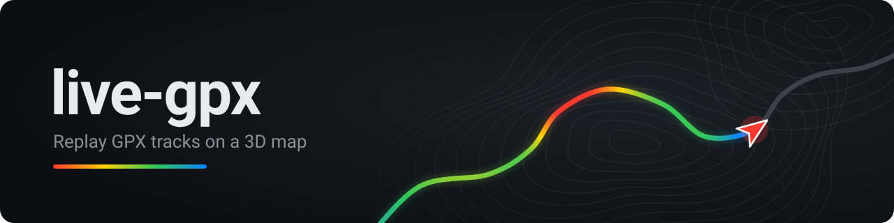

Replay a recorded GPX track on a 3D map, with a chase camera that follows the
rider and telemetry charts alongside. For anyone who wants to re-watch a ride,
run, or route in the browser — no account, no upload, nothing leaves the page.

<!-- Add a screenshot or short GIF of a replay here; it carries this README. -->

## Features

- **3D chase camera** — The map tilts and follows the rider, pacing the camera to the track.
- **Speed-colored trail** — The route is tinted by speed; a moving boundary reveals it as playback advances.
- **Telemetry panel** — Live speed, altitude, distance, time, and heart rate / power when the file has them.
- **Charts** — uPlot speed and elevation plots with a cursor tied to the replay.
- **Variable speed** — Play at 1×, 2×, 4×, or 8×.
- **Drop-in** — Drag a GPX file onto the page, or pick one. Routes without timing get synthetic 1 Hz timing.
- **Keyless hosting** — Uses public Esri imagery, so it runs as a static page with no API keys.

## Keyboard shortcuts

| Key          | Action              |
| ------------ | ------------------- |
| Space        | Play / pause        |
| ← / →        | Seek 5 s back / forward |
| ↑ / ↓        | Zoom in / out       |
